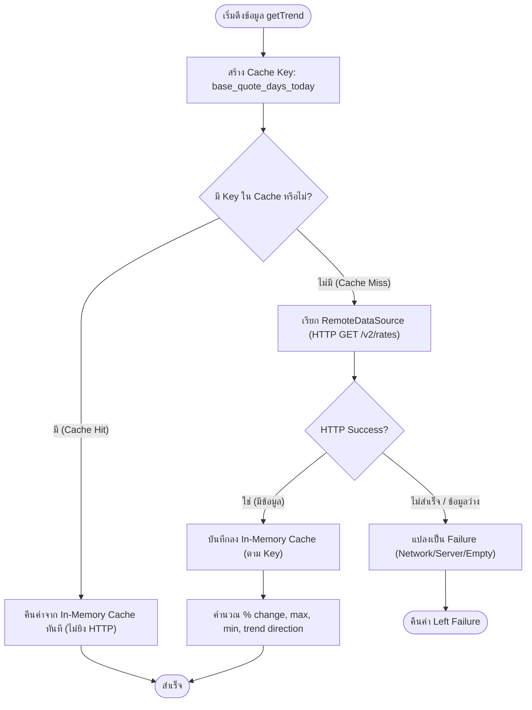

# สเปคเชิงเทคนิคฝั่งเซอร์วิสและข้อมูล (Backend & Data Technical Specification)

> **อ้างอิง Issue:** #2 — `[Service] Develop: API Client เชื่อมต่อ Frankfurter API พร้อมระบบแคชข้อมูลรายวัน`  
> **ใบงานหลัก:** #1 — `[Story] MAT 15: ระบบดูกราฟแนวโน้มอัตราแลกเปลี่ยน (Exchange Rate Trend)`  
> **ผู้จัดทำ:** Subagent `spec-be`  
> **วันที่จัดทำ:** 2026-11-04  
> **มาตรฐานสถาปัตยกรรม:** [Project SDD §1, §2, §3, §4](file:///Users/hatsawat.i/Desktop/Dev/training/docs/sdd/)

---

## 1. ภาพรวมและขอบเขตทางเทคนิค (Technical Overview & Scope)

เอกสารนี้กำหนดข้อกำหนดเชิงเทคนิค (Technical Spec) สำหรับ Service และ Data Layer ของฟีเจอร์ MAT 15 เพื่อเป็นพิมพ์เขียว (Blueprint) ให้แก่ `test-author` (เขียนเทส TDD) และ `implementer` (เขียนโค้ด) ใน Stage C โดยครอบคลุม:
1. การเชื่อมต่อ Frankfurter API v2 (`/v2/rates`) ด้วย `DioClient`
2. การแปลงข้อมูลดิบ (JSON Array / Map) เข้าสู่ Model DTOs และ Domain Entities
3. ระบบแคชข้อมูลรายวัน (Daily In-Memory Caching)
4. การคำนวณสถิติและกฎทางธุรกิจ (BR-1, BR-3, BR-4, BR-6)
5. การจัดการข้อผิดพลาด (Exception to Failure Mapping)
6. การสร้าง Lightweight `Either<L, R>` Type ปลอด Dependency ภายนอก
7. แผนการจัดวางและโครงสร้างไฟล์ 15 ไฟล์เป้าหมายตาม Clean Architecture

---

## 2. ข้อกำหนด API ภายนอก (Frankfurter API v2 Contract)

ระบบเชื่อมต่อกับ Frankfurter API (Free & Open-Source Currency Data API โดยไม่มีการใช้ API Key):

### 2.1 Endpoint Specification

| รายการ | รายละเอียดทางเทคนิค |
|---|---|
| **Base URL** | `https://api.frankfurter.dev` |
| **Path** | `/v2/rates` |
| **HTTP Method** | `GET` |
| **Headers** | `Accept: application/json` |
| **Timeout Config** | Connect Timeout: 10,000 ms (10s), Receive Timeout: 10,000 ms (10s) |

### 2.2 Query Parameters

| Parameter | Type | Required | Format / Example | คำอธิบายและกฎที่เกี่ยวข้อง |
|---|---|---|---|---|
| `from` | `String` | ใช่ | `2026-09-29` | วันที่เริ่มต้น (คำนวณตาม BR-1: `today - days`) รูปแบบ `YYYY-MM-DD` |
| `to` | `String` | ใช่ | `2026-10-29` | วันที่สิ้นสุด (วันที่ปัจจุบัน) รูปแบบ `YYYY-MM-DD` |
| `base` | `String` | ใช่ | `USD` | สกุลเงินต้นทาง (ISO 4217, 3 ตัวอักษรตัวพิมพ์ใหญ่) |
| `quotes` | `String` | ใช่ | `THB` | สกุลเงินปลายทางที่ต้องการแปลง (ISO 4217, 3 ตัวอักษรตัวพิมพ์ใหญ่) |

> **ตัวอย่าง HTTP Request URL เต็ม:**
> ```http
> GET https://api.frankfurter.dev/v2/rates?from=2026-09-29&to=2026-10-29&base=USD&quotes=THB HTTP/1.1
> Host: api.frankfurter.dev
> Accept: application/json
> ```

### 2.3 Response JSON Payload Structures

#### ก) สถานะสำเร็จ (HTTP 200 OK — มีข้อมูลประวัติอัตราแลกเปลี่ยน)
API คืนค่าเป็น JSON Array ของอ็อบเจกต์รายวัน เรียงลำดับวันที่จากอดีตไปหาปัจจุบัน:
```json
[
  {
    "date": "2026-09-29",
    "base": "USD",
    "quote": "THB",
    "rate": 33.568
  },
  {
    "date": "2026-09-30",
    "base": "USD",
    "quote": "THB",
    "rate": 33.551
  },
  {
    "date": "2026-10-29",
    "base": "USD",
    "quote": "THB",
    "rate": 33.750
  }
]
```

#### ข) สถานะสำเร็จแต่ไม่มีข้อมูล (HTTP 200 OK — Empty Data ตาม BR-6)
กรณีช่วงเวลาที่เลือกไม่มีข้อมูล (เช่น วันหยุดยาว หรือสกุลเงินไม่มีการเทรด):
```json
[]
```

#### ค) สถานะข้อผิดพลาดของพารามิเตอร์ (HTTP 422 Unprocessable Entity)
```json
{
  "message": "not found or invalid parameter"
}
```

#### ง) สถานะเซิร์ฟเวอร์ขัดข้อง (HTTP 500 Internal Server Error)
```json
{
  "message": "internal server error"
}
```

---

## 3. โครงสร้างโมเดลข้อมูลและการแปลงข้อมูล (Entities & DTOs Modeling)

### 3.1 Domain Entities (Pure Dart — `lib/features/exchange_rate/domain/entities/`)

Domain Entities ต้องเป็น Immutable Class ที่สืบทอดจาก `Equatable` และไม่มีการ Import โค้ดจากภายนอกหรือ Flutter Framework:

#### 1. `CurrencyPair` (`currency_pair.dart`)
```dart
import 'package:equatable/equatable.dart';

class CurrencyPair extends Equatable {
  final String base;
  final String quote;

  const CurrencyPair({
    required this.base,
    required this.quote,
  });

  static const defaultPair = CurrencyPair(base: 'USD', quote: 'THB');

  const CurrencyPair.defaultPair()
      : base = 'USD',
        quote = 'THB';

  @override
  List<Object?> get props => [base, quote];
}
```

#### 2. `RatePoint` (`rate_point.dart`)
```dart
import 'package:equatable/equatable.dart';

class RatePoint extends Equatable {
  final DateTime date;
  final double rate;
  final String base;
  final String quote;

  const RatePoint({
    required this.date,
    required this.rate,
    required this.base,
    required this.quote,
  });

  @override
  List<Object?> get props => [date, rate, base, quote];
}
```

#### 3. `TrendDirection` และ `ExchangeRateTrend` (`exchange_rate_trend.dart`)
```dart
import 'package:equatable/equatable.dart';
import 'currency_pair.dart';
import 'rate_point.dart';

enum TrendDirection {
  up,      // สูงขึ้น (ค่า % เปลี่ยนแปลง > 0)
  down,    // ลดลง (ค่า % เปลี่ยนแปลง < 0)
  neutral, // ทรงตัว (ค่า % เปลี่ยนแปลง == 0)
}

class ExchangeRateTrend extends Equatable {
  final CurrencyPair pair;
  final int days;
  final List<RatePoint> points;
  final double maxRate;
  final double minRate;
  final double changePercentage;
  final TrendDirection trendDirection;

  const ExchangeRateTrend({
    required this.pair,
    required this.days,
    required this.points,
    required this.maxRate,
    required this.minRate,
    required this.changePercentage,
    required this.trendDirection,
  });

  @override
  List<Object?> get props => [
        pair,
        days,
        points,
        maxRate,
        minRate,
        changePercentage,
        trendDirection,
      ];
}
```

### 3.2 Data Transfer Object (DTO — `lib/features/exchange_rate/data/models/rate_point_model.dart`)

`RatePointModel` ขยายมาจาก `RatePoint` รองรับการ Parse ข้อมูลทั้งแบบ JSON Array รายวัน และรองรับการจัดการ Type ปลอดภัย (`num` -> `double`, `String` -> `DateTime`):

```dart
import '../../domain/entities/rate_point.dart';

class RatePointModel extends RatePoint {
  const RatePointModel({
    required super.date,
    required super.rate,
    required super.base,
    required super.quote,
  });

  /// แปลงจาก Map Object เดี่ยว: {"date": "2026-09-29", "base": "USD", "quote": "THB", "rate": 33.568}
  factory RatePointModel.fromJson(Map<String, dynamic> json) {
    return RatePointModel(
      date: DateTime.parse(json['date'] as String),
      rate: (json['rate'] as num).toDouble(),
      base: (json['base'] as String?) ?? '',
      quote: (json['quote'] as String?) ?? '',
    );
  }

  /// แปลงจาก List of Dynamic (Response จาก Frankfurter /v2/rates)
  static List<RatePointModel> fromJsonList(List<dynamic> jsonList) {
    return jsonList
        .map((item) => RatePointModel.fromJson(item as Map<String, dynamic>))
        .toList();
  }

  /// แปลงกลับเป็น Map (สำหรับ Caching หรือ Serialization)
  Map<String, dynamic> toJson() {
    return {
      'date': date.toIso8601String().split('T').first,
      'rate': rate,
      'base': base,
      'quote': quote,
    };
  }
}
```

---

## 4. สถาปัตยกรรมระบบแคชข้อมูลรายวัน (Daily Caching Architecture)

ตามข้อกำหนด **BR-2** และ **AC-4**: เมื่อผู้ใช้สลับช่วงเวลา เช่น 30 วัน ➔ 7 วัน ➔ 30 วัน ระบบต้องไม่ยิงคำขอ Network Request ซ้ำสำหรับช่วง 30 วันเดิมในวันเดียวกัน

### 4.1 กลยุทธ์และการจัดเก็บแคช (Caching Strategy)
- **เลเยอร์:** `ExchangeRateLocalDataSource`
- **โครงสร้างข้อมูล:** In-Memory Cache โดยใช้ `Map<String, List<RatePointModel>>` (หรือ `Map<String, ExchangeRateTrend>`)
- **ความสามารถในการขยาย:** ออกแบบ Interface สัญญาให้สลับไปใช้ `SharedPreferences` หรือ Local Storage อื่น ๆ ได้ในอนาคต

### 4.2 รูปแบบคีย์ของแคช (Daily Cache Key Format)
คีย์ต้องประกอบด้วย สกุลเงินต้นทาง, สกุลเงินปลายทาง, จำนวนวันของช่วงเวลา, และวันที่ปัจจุบัน (YYYY-MM-DD):

$$\text{Cache Key} = \text{\$\{base\}\_\$\{quote\}\_\$\{days\}\_\$\{currentDate\}}$$

**ตัวอย่าง:**
- `USD_THB_30_2026-11-04` (สำหรับ USD/THB ช่วง 30 วัน ของวันที่ 4 พ.ย. 2026)
- `USD_THB_7_2026-11-04` (สำหรับ USD/THB ช่วง 7 วัน ของวันที่ 4 พ.ย. 2026)
- `EUR_THB_90_2026-11-04` (สำหรับ EUR/THB ช่วง 90 วัน ของวันที่ 4 พ.ย. 2026)

### 4.3 นโยบายความถูกต้องของแคช (Cache Policy: Hit / Miss & Same-day Validity)



- **Cache Hit:** ข้อมูลมีอยู่ใน Cache Map ➔ คืนค่าทันที ไม่เกิด Network latency
- **Cache Miss:** ไม่พบใน Cache Map (คำขอครั้งแรก หรือเปลี่ยนช่วงวัน) ➔ ยิง Remote API ➔ ได้รับผลลัพธ์แล้วบันทึกลง Cache Map
- **Same-day Validity (อายุข้อมูล):** ข้อมูลอัตราแลกเปลี่ยนในอดีตของวันเดียวกันจะไม่มีการเปลี่ยนแปลง เมื่อข้ามวันใหม่ วันที่ในคีย์เปลี่ยนอัตโนมัติ ทำให้เกิด Cache Miss และดึงข้อมูลอัปเดตใหม่โดยธรรมชาติ

---

## 5. กฎทางธุรกิจและขั้นตอนวิธีคำนวณ (Business Rules & Algorithms)

### 5.1 BR-1: การคำนวณช่วงวันที่ย้อนหลัง (`DateFormatter`)
- `to`: วันที่ปัจจุบัน รูปแบบ `YYYY-MM-DD` (เช่น `2026-10-29`)
- `from`: วันที่ปัจจุบันลบด้วยจำนวนวัน (`days` = 7, 30, 90) รูปแบบ `YYYY-MM-DD`
  - สูตร: `fromDate = today.subtract(Duration(days: days))`
  - ตัวอย่าง: หากวันนี้คือ `2026-10-29` และเลือก 30 วัน ➔ `from = 2026-09-29`
- **ฟังก์ชันใน `DateFormatter` (`lib/core/utils/date_formatter.dart`):**
  ```dart
  class DateFormatter {
    static String formatYMD(DateTime date) {
      final y = date.year.toString().padLeft(4, '0');
      final m = date.month.toString().padLeft(2, '0');
      final d = date.day.toString().padLeft(2, '0');
      return '$y-$m-$d';
    }

    static ({String from, String to}) calculateDateRange({
      required int days,
      DateTime? now,
    }) {
      final current = now ?? DateTime.now();
      final today = DateTime(current.year, current.month, current.day);
      final past = today.subtract(Duration(days: days));
      return (from: formatYMD(past), to: formatYMD(today));
    }
  }
  ```

### 5.2 BR-3: สูตรคำนวณเปอร์เซ็นต์การเปลี่ยนแปลง (`TrendCalculator`)
คำนวณการเปลี่ยนแปลงระหว่างจุดแรกของช่วงเวลากับจุดสุดท้ายของช่วงเวลา:

$$\text{changePercentage} = \frac{\text{lastRate} - \text{firstRate}}{\text{firstRate}} \times 100$$

- **กฎการปัดเศษ:** ปัดทศนิยม 2 ตำแหน่งด้วยหลักสถิติมาตรฐาน (`toStringAsFixed(2)`)
- **กรณีพิเศษ (Edge Cases):**
  - หาก `points` มีน้อยกว่า 2 จุด หรือ `firstRate == 0` ให้คืนค่า `0.0`
- **การทดสอบตาม AC-2:**
  - Input: `firstRate = 33.568`, `lastRate = 33.750`
  - คำนวณ: `((33.750 - 33.568) / 33.568) * 100` = `0.54218303...`
  - ปัดทศนิยม 2 ตำแหน่ง ➔ `0.54` (ตรงตาม AC-2: `+0.54%`)

### 5.3 BR-4: การกำหนดทิศทางแนวโน้ม (Trend Direction)
- หาก `changePercentage > 0` ➔ `TrendDirection.up` ("สูงขึ้น")
- หาก `changePercentage < 0` ➔ `TrendDirection.down` ("ลดลง")
- หาก `changePercentage == 0` ➔ `TrendDirection.neutral` ("ทรงตัว")

### 5.4 การคำนวณค่าสูงสุดและต่ำสุด (Max / Min Rate)
- `maxRate` = ค่า `rate` ที่มากที่สุดในลิสต์ `points`
- `minRate` = ค่า `rate` ที่น้อยที่สุดในลิสต์ `points`

```dart
class TrendCalculator {
  static double calculateChangePercentage({
    required double firstRate,
    required double lastRate,
  }) {
    if (firstRate == 0) return 0.0;
    final change = ((lastRate - firstRate) / firstRate) * 100.0;
    return double.parse(change.toStringAsFixed(2));
  }

  static TrendDirection resolveTrendDirection(double changePercentage) {
    if (changePercentage > 0) return TrendDirection.up;
    if (changePercentage < 0) return TrendDirection.down;
    return TrendDirection.neutral;
  }

  static double findMaxRate(List<RatePoint> points) {
    if (points.isEmpty) return 0.0;
    return points.map((p) => p.rate).reduce((a, b) => a > b ? a : b);
  }

  static double findMinRate(List<RatePoint> points) {
    if (points.isEmpty) return 0.0;
    return points.map((p) => p.rate).reduce((a, b) => a < b ? a : b);
  }
}
```

### 5.5 BR-6: การจัดการสถานะข้อมูลว่าง (Empty State Handling)
เมื่อเรียก API แล้วได้ผลลัพธ์เป็น Array ว่างเปล่า `[]`:
- RemoteDataSource ตรวจจับ `jsonList.isEmpty`
- Data Layer ส่งต่อ `EmptyDataException(message: 'ไม่มีข้อมูลในช่วงนี้')`
- Repository แปลงเป็น `Left(EmptyDataFailure(message: 'ไม่มีข้อมูลในช่วงนี้'))`
- ส่งผลให้ Presentation Layer สลับไปแสดงผล **Empty State Widget (15-1c)** โดยไม่แครช

---

## 6. สถาปัตยกรรมการจัดการข้อผิดพลาด (Error Handling & Failure Mapping)

### 6.1 โครงสร้าง Exceptions (Data Layer — `lib/core/errors/exceptions.dart`)
```dart
class ServerException implements Exception {
  final String message;
  const ServerException([this.message = 'เกิดข้อผิดพลาดจากเซิร์ฟเวอร์']);
}

class NetworkException implements Exception {
  final String message;
  const NetworkException([this.message = 'ไม่สามารถเชื่อมต่ออินเทอร์เน็ตได้']);
}

class EmptyDataException implements Exception {
  final String message;
  const EmptyDataException([this.message = 'ไม่มีข้อมูลในช่วงนี้']);
}

class CacheException implements Exception {
  final String message;
  const CacheException([this.message = 'เกิดข้อผิดพลาดในการเข้าถึงแคช']);
}
```

### 6.2 โครงสร้าง Failures (Domain Layer — `lib/core/errors/failures.dart`)
```dart
import 'package:equatable/equatable.dart';

abstract class Failure extends Equatable {
  final String message;
  const Failure(this.message);

  @override
  List<Object?> get props => [message];
}

class ServerFailure extends Failure {
  const ServerFailure([super.message = 'ดึงข้อมูลไม่สำเร็จ']);
}

class NetworkFailure extends Failure {
  const NetworkFailure([super.message = 'ไม่สามารถเชื่อมต่ออินเทอร์เน็ตได้']);
}

class EmptyDataFailure extends Failure {
  const EmptyDataFailure([super.message = 'ไม่มีข้อมูลในช่วงนี้']);
}

class CacheFailure extends Failure {
  const CacheFailure([super.message = 'เกิดข้อผิดพลาดของระบบแคช']);
}
```

### 6.3 การแปลง DioException เข้าสู่ Failures (Mapping Matrix)

| ปัญหาที่เกิดในเครือข่าย | ประเภท `DioExceptionType` | Exception ที่โยน | Failure ที่ส่งต่อให้ UI | ผลลัพธ์ใน UI |
|---|---|---|---|---|
| ต่อไม่ติด / Timeout | `connectionTimeout`, `sendTimeout`, `receiveTimeout` | `NetworkException('การเชื่อมต่อหมดเวลา')` | `NetworkFailure` | แสดง 15-1d + ปุ่มลองอีกครั้ง |
| ไม่มีอินเทอร์เน็ต | `connectionError` | `NetworkException('ไม่สามารถเชื่อมต่ออินเทอร์เน็ตได้')` | `NetworkFailure` | แสดง 15-1d + ปุ่มลองอีกครั้ง |
| ข้อมูลพารามิเตอร์ผิด | `badResponse` (HTTP 422) | `ServerException('พารามิเตอร์ไม่ถูกต้อง')` | `ServerFailure` | แสดง 15-1d + ปุ่มลองอีกครั้ง |
| เซิร์ฟเวอร์ล่ม | `badResponse` (HTTP 500, 502, 503) | `ServerException('ดึงข้อมูลไม่สำเร็จ')` | `ServerFailure` | แสดง 15-1d + ปุ่มลองอีกครั้ง |
| ข้อมูลว่าง (BR-6) | HTTP 200 แต่ได้ `[]` | `EmptyDataException('ไม่มีข้อมูลในช่วงนี้')` | `EmptyDataFailure` | แสดง 15-1c (Empty State) |

---

## 7. นิยาม Lightweight `Either<L, R>` Type (Zero-Dependency FP)

เนื่องจากโปรเจกต์ MAT 15 ยึดหลัก Lean & Clean Architecture ใน Dart 3 โดยไม่ติดตั้ง Package Functional Programming ขนาดใหญ่ภายนอก (เช่น `dartz` หรือ `fpdart`) ให้สร้าง Sealed Class ใน `lib/core/errors/failures.dart`:

```dart
/// Lightweight Either implementation รองรับ Pattern Matching ใน Dart 3
sealed class Either<L, R> {
  const Either();

  bool get isLeft => this is Left<L, R>;
  bool get isRight => this is Right<L, R>;

  T fold<T>(T Function(L left) onLeft, T Function(R right) onRight);
}

class Left<L, R> extends Either<L, R> {
  final L value;
  const Left(this.value);

  @override
  T fold<T>(T Function(L left) onLeft, T Function(R right) onRight) => onLeft(value);

  @override
  bool operator ==(Object other) =>
      identical(this, other) || (other is Left && other.value == value);

  @override
  int get hashCode => value.hashCode;
}

class Right<L, R> extends Either<L, R> {
  final R value;
  const Right(this.value);

  @override
  T fold<T>(T Function(L left) onLeft, T Function(R right) onRight) => onRight(value);

  @override
  bool operator ==(Object other) =>
      identical(this, other) || (other is Right && other.value == value);

  @override
  int get hashCode => value.hashCode;
}
```

---

## 8. ผังการจัดวางและรายละเอียด 15 ไฟล์เป้าหมาย (15 Target Files Breakdown)

ตามข้อกำหนดใน Clean Architecture (SDD §2) และ Workspec ฝั่ง Service รายชื่อไฟล์ทั้ง 15 ไฟล์ที่จะสร้างขึ้นใน `app/` มีดังนี้:

```text
app/
├── lib/
│   ├── core/
│   │   ├── network/
│   │   │   ├── dio_client.dart           # [1] Dio Factory พร้อม Timeout Interceptors
│   │   │   └── api_endpoints.dart        # [2] Constants Base URL และ Path /v2/rates
│   │   ├── errors/
│   │   │   ├── failures.dart             # [3] Failure hierarchy + Either<L, R>
│   │   │   └── exceptions.dart           # [4] Data Layer Exception hierarchy
│   │   └── utils/
│   │       ├── date_formatter.dart       # [5] BR-1: จัดรูปแบบและคำนวณช่วงวัน YYYY-MM-DD
│   │       └── trend_calculator.dart     # [6] BR-3/BR-4: คำนวณ % change, max, min, direction
│   └── features/
│       └── exchange_rate/
│           ├── domain/
│           │   ├── entities/
│           │   │   ├── rate_point.dart   # [7] Entity จุดข้อมูลอัตราแลกเปลี่ยน
│           │   │   ├── currency_pair.dart# [8] Entity คู่สกุลเงิน (base, quote)
│           │   │   └── exchange_rate_trend.dart # [9] Entity สรุปแนวโน้มและ TrendDirection
│           │   ├── repositories/
│           │   │   └── exchange_rate_repository.dart # [10] Repository Contract Interface
│           │   └── usecases/
│           │       └── get_exchange_rate_trend_usecase.dart # [11] UseCase ดึงแนวโน้ม
│           └── data/
│               ├── models/
│               │   └── rate_point_model.dart # [12] DTO parse JSON จาก API
│               ├── datasources/
│               │   ├── exchange_rate_remote_datasource.dart # [13] เรียก API ด้วย DioClient
│               │   └── exchange_rate_local_datasource.dart  # [14] In-Memory Cache รายวัน (BR-2)
│               └── repositories/
│                   └── exchange_rate_repository_impl.dart   # [15] ประสานงาน Cache + Remote + คำนวณ
```

### รายละเอียดโครงสร้างคลาสใน 15 ไฟล์หลัก

| # | ไฟล์เป้าหมาย | Class / Type สำคัญ | Method / หน้าที่สำคัญ |
|---|---|---|---|
| 1 | `lib/core/network/dio_client.dart` | `DioClient` | `static Dio createDio()` สร้าง instance พร้อม BaseOptions, timeout 10s |
| 2 | `lib/core/network/api_endpoints.dart` | `ApiEndpoints` | `static const String baseUrl`, `static const String rates = '/v2/rates'` |
| 3 | `lib/core/errors/failures.dart` | `Failure`, `ServerFailure`, `NetworkFailure`, `EmptyDataFailure`, `Either<L, R>` | โครงสร้าง Result monad และ Error Entity สำหรับส่งต่อให้ UI |
| 4 | `lib/core/errors/exceptions.dart` | `ServerException`, `NetworkException`, `EmptyDataException`, `CacheException` | Exception ภายใน Data Layer |
| 5 | `lib/core/utils/date_formatter.dart` | `DateFormatter` | `calculateDateRange(days: int)` คืน record `(from, to)` ตาม BR-1 |
| 6 | `lib/core/utils/trend_calculator.dart`| `TrendCalculator` | `calculateChangePercentage()`, `findMaxRate()`, `findMinRate()`, `resolveTrendDirection()` |
| 7 | `lib/features/exchange_rate/domain/entities/rate_point.dart` | `RatePoint` | Entity สำหรับจุดอัตราแลกเปลี่ยน (date, rate, base, quote) |
| 8 | `lib/features/exchange_rate/domain/entities/currency_pair.dart` | `CurrencyPair` | Entity คู่สกุลเงิน (ค่าเริ่มต้น: `USD`, `THB`) |
| 9 | `lib/features/exchange_rate/domain/entities/exchange_rate_trend.dart` | `ExchangeRateTrend`, `TrendDirection` | Entity ผลสรุปแนวโน้ม (pair, days, points, max, min, change %, direction) |
| 10 | `lib/features/exchange_rate/domain/repositories/exchange_rate_repository.dart` | `ExchangeRateRepository` | Contract: `Future<Either<Failure, ExchangeRateTrend>> getTrend({required CurrencyPair pair, required int days});` |
| 11 | `lib/features/exchange_rate/domain/usecases/get_exchange_rate_trend_usecase.dart` | `GetExchangeRateTrendUseCase` | `Future<Either<Failure, ExchangeRateTrend>> call({required CurrencyPair pair, required int days})` |
| 12 | `lib/features/exchange_rate/data/models/rate_point_model.dart` | `RatePointModel` | `fromJson(Map)`, `fromJsonList(List)`, `toJson()` |
| 13 | `lib/features/exchange_rate/data/datasources/exchange_rate_remote_datasource.dart` | `ExchangeRateRemoteDataSource` | `Future<List<RatePointModel>> getRates({required CurrencyPair pair, required String from, required String to})` |
| 14 | `lib/features/exchange_rate/data/datasources/exchange_rate_local_datasource.dart` | `ExchangeRateLocalDataSource` | `List<RatePointModel>? getCachedRates(String key)`, `void cacheRates(String key, List<RatePointModel> data)` |
| 15 | `lib/features/exchange_rate/data/repositories/exchange_rate_repository_impl.dart` | `ExchangeRateRepositoryImpl` | ตรวจสอบ Local Cache ก่อน ➔ หาก Miss เรียก Remote ➔ คำนวณสถิติ ➔ คืน `Right(ExchangeRateTrend)` หรือ `Left(Failure)` |

---

## 9. ข้อมูลจำเพาะสำหรับชุดทดสอบอัตโนมัติ (Automated Unit Tests Matrix)

ในกระบวนการ TDD (Stage C) ฝั่ง Service & Data Layer จะต้องมีชุด Automated Test 6 ไฟล์ ดังนี้:

| ไฟล์ทดสอบ | Target Class | สิ่งที่ทดสอบและเกณฑ์การตรวจ | อ้างอิง AC |
|---|---|---|---|
| `test/core/utils/trend_calculator_test.dart` | `TrendCalculator` | - คำนวณ % change จาก 33.568 ➔ 33.750 ได้ `+0.54%`<br>- ระบุ `TrendDirection.up` เมื่อเป็นบวก, `down` เมื่อเป็นลบ, `neutral` เมื่อเป็น 0<br>- หาค่า Max (33.750) และ Min (33.551) ถูกต้อง | **AC-2** |
| `test/core/utils/date_formatter_test.dart` | `DateFormatter` | - คำนวณช่วงวัน 7, 30, 90 วันย้อนหลังได้ถูกต้องตามรูปแบบ `YYYY-MM-DD` (BR-1) | **BR-1** |
| `test/features/exchange_rate/data/datasources/exchange_rate_remote_datasource_test.dart` | `ExchangeRateRemoteDataSource` | - ส่ง GET request พร้อม query params ถูกต้อง<br>- แปลง JSON สำเร็จ คืน `List<RatePointModel>`<br>- โยน `EmptyDataException` เมื่อได้ `[]`<br>- โยน `NetworkException` เมื่อ Connection Timeout<br>- โยน `ServerException` เมื่อได้ HTTP 422 หรือ 500 | **AC-5, BR-6** |
| `test/features/exchange_rate/data/datasources/exchange_rate_local_datasource_test.dart` | `ExchangeRateLocalDataSource` | - คืนค่า null เมื่อไม่มี key ในแคช<br>- คืนข้อมูลเดิมถูกต้องเมื่อดึงด้วย key เดิมที่เคยแคชไว้<br>- คีย์สร้างในรูปแบบ `${base}_${quote}_${days}_${currentDate}` | **AC-4, BR-2** |
| `test/features/exchange_rate/data/repositories/exchange_rate_repository_impl_test.dart` | `ExchangeRateRepositoryImpl` | - เมื่อมีแคช: ไม่เรียก RemoteDataSource ซ้ำ และคืน `Right(ExchangeRateTrend)` ทันที<br>- เมื่อไม่มีแคช: เรียก RemoteDataSource, บันทึกลงแคช และคำนวณผลลัพธ์สถิติถูกต้อง<br>- เมื่อเกิด Dio Exception: คืนค่า `Left(NetworkFailure)` หรือ `Left(ServerFailure)`<br>- เมื่อข้อมูลว่าง: คืนค่า `Left(EmptyDataFailure)` | **AC-4, AC-5** |
| `test/features/exchange_rate/domain/usecases/get_exchange_rate_trend_usecase_test.dart` | `GetExchangeRateTrendUseCase` | - ส่งต่อ `CurrencyPair` และ `days` ให้กับ `ExchangeRateRepository` และคืนผลลัพธ์ `Either` โดยไม่ดัดแปลง | **SDD §2** |

---

## 10. สรุปความพร้อมส่งมอบสู่ขั้นตอนถัดไป (Handoff Summary)

สเปคเชิงเทคนิคนี้พร้อมสำหรับการ:
1. ส่งมอบให้ `contract-checker` เปรียบเทียบสัญญากับ `spec-fe.md` (จุดบรรจบ 1)
2. ส่งมอบให้ `test-author` ออกแบบ Test Cases ใน `testplan.md`
3. เป็นเอกสารอ้างอิงให้ `implementer` ลงมือเขียนโค้ดทั้ง 15 ไฟล์ใน Stage C

---
อ้างอิง SDD: §2 โครงสร้างโฟลเดอร์และขอบเขตเลเยอร์, §3 ข้อกำหนด API และสัญญาการแลกเปลี่ยนข้อมูล และ §4 มาตรฐานการทดสอบและแนวทาง TDD  
ลิงก์: [docs/sdd/02-architecture-layout.md](file:///Users/hatsawat.i/Desktop/Dev/training/docs/sdd/02-architecture-layout.md) · [docs/sdd/03-api-contract.md](file:///Users/hatsawat.i/Desktop/Dev/training/docs/sdd/03-api-contract.md) · [docs/sdd/04-testing-guidelines.md](file:///Users/hatsawat.i/Desktop/Dev/training/docs/sdd/04-testing-guidelines.md)
