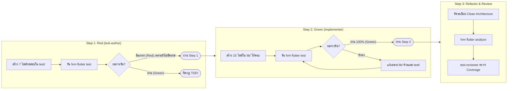

# แผนการทดสอบเชิงเทคนิค (Technical Test Plan) — Issue #2: API Client & Caching Service

> **อ้างอิง Issue:** #2 — `[Service] Develop: API Client เชื่อมต่อ Frankfurter API พร้อมระบบแคชข้อมูลรายวัน`  
> **ใบงานหลัก:** Issue #1 — `[Story] MAT 15: ระบบดูกราฟแนวโน้มอัตราแลกเปลี่ยน (Exchange Rate Trend)`  
> **ผู้จัดทำ:** Subagent `test-author` (Planning Mode ใน Stage B)  
> **วันที่จัดทำ:** 2026-11-04  
> **มาตรฐานสถาปัตยกรรม:** [Project SDD §1, §2, §3, §4](file:///Users/hatsawat.i/Desktop/Dev/training/docs/sdd/)  
> **เอกสารอ้างอิง:**
> - สเปคหน้าจอ: [`docs/workspecs/2/spec-fe.md`](file:///Users/hatsawat.i/Desktop/Dev/training/docs/workspecs/2/spec-fe.md)
> - สเปคเซอร์วิสและข้อมูล: [`docs/workspecs/2/spec-be.md`](file:///Users/hatsawat.i/Desktop/Dev/training/docs/workspecs/2/spec-be.md)
> - รายงานตรวจสัญญา: [`docs/workspecs/2/contract-report.md`](file:///Users/hatsawat.i/Desktop/Dev/training/docs/workspecs/2/contract-report.md)
> - มาตรฐานการทดสอบ: [`docs/sdd/04-testing-guidelines.md`](file:///Users/hatsawat.i/Desktop/Dev/training/docs/sdd/04-testing-guidelines.md)

---

## 1. บทสรุปและเมทริกซ์ความเชื่อมโยง (Test Strategy & Traceability Matrix)

เอกสารนี้แปลง Acceptance Criteria (**AC-1 ถึง AC-6**) และ Business Rules (**BR-1 ถึง BR-6**) ของ Issue #2 ให้เป็นแผนการทดสอบที่รัดกุมรอบด้าน โดยจำแนกเคสออกเป็น 3 ประเภทตามหลักการ **SDD Automation-First**:
1. 🤖 **Automated Tests:** Unit Tests และ Mock Data Layer ที่รันอัตโนมัติด้วย `flutter_test` และ `mocktail` (เป็นฐานสำหรับ TDD ใน Stage C)
2. 👁️ **Review Tests:** จุดตรวจด้วยสายตาโดยมนุษย์ตอนทำ Code Review บน GitHub PR (Gate 7)
3. 🙋 **Manual QA Tests:** การทดสอบมือโดยมนุษย์ในสภาพแวดล้อมจริงที่ Stage D (Network จริง, โหมดเครื่องบิน, แดชบอร์ดตรวจสอบ)

### 1.1 ตารางความเชื่อมโยงครอบคลุมข้อกำหนด (AC Traceability Matrix)

| Acceptance Criteria / กฎธุรกิจ | หมวดหมู่การทดสอบ | ไฟล์ / ตำแหน่งตรวจ | จุดประสงค์และเงื่อนไขการตรวจ |
|---|---|---|---|
| **AC-1:** แสดงกราฟเส้นย้อนหลัง 30 วัน (ค่าเริ่มต้น) พร้อมค่า Max / Min | 🤖 Automated<br>👁️ Review | `test/core/utils/date_formatter_test.dart`<br>`test/core/utils/trend_calculator_test.dart` | - คำนวณช่วงวันย้อนหลัง 30 วันเป็นค่าเริ่มต้น (BR-1)<br>- คำนวณ `findMaxRate` และ `findMinRate` ถูกต้อง |
| **AC-2:** สูตร % Change `((last-first)/first)*100` เช่น 33.568 ➔ 33.750 = `+0.54%` (Up) | 🤖 Automated | `test/core/utils/trend_calculator_test.dart` | - คำนวณได้ `+0.54%` ปัดทศนิยม 2 ตำแหน่ง<br>- คืน `TrendDirection.up` เมื่อบวก, `down` เมื่อลบ, `neutral` เมื่อศูนย์<br>- รองรับ Edge Cases (ค่าแรกเป็น 0, ข้อมูลน้อย) |
| **AC-3:** แตะจุดกราฟแสดงวันที่และเรต | 🤖 Automated | `test/features/exchange_rate/data/models/rate_point_model_test.dart` | - แปลง JSON เข้าสู่ `RatePointModel` โดยรักษาความแม่นยำของ `DateTime` และ `double rate` ครบทุกจุด |
| **AC-4:** สลับช่วง 7 วันยิง API ใหม่, สลับกลับ 30 วันดึงแคชเดิม | 🤖 Automated<br>🙋 Manual QA | `test/features/exchange_rate/data/datasources/exchange_rate_local_datasource_test.dart`<br>`test/features/exchange_rate/data/repositories/exchange_rate_repository_impl_test.dart` | - Key: `${base}_${quote}_${days}_${currentDate}` (BR-2)<br>- สลับ 30d ➔ 7d (remote) ➔ 30d (cache hit 100% ไม่ยิง HTTP ซ้ำ)<br>- วันใหม่เกิด Invalidation อัตโนมัติ |
| **AC-5:** ข้อผิดพลาดเครือข่าย/เซิร์ฟเวอร์คืน Failure ให้ UI จัดการ | 🤖 Automated<br>🙋 Manual QA | `test/features/exchange_rate/data/datasources/exchange_rate_remote_datasource_test.dart`<br>`test/features/exchange_rate/data/repositories/exchange_rate_repository_impl_test.dart` | - แปลง DioException timeout/no connection เป็น `NetworkFailure`<br>- แปลง HTTP 422/500 เป็น `ServerFailure`<br>- แปลง `[]` ว่างเป็น `EmptyDataFailure` (BR-6) |
| **AC-6:** ที่มาข้อมูล Frankfurter API | 🤖 Automated<br>👁️ Review | `test/features/exchange_rate/data/datasources/exchange_rate_remote_datasource_test.dart` | - ตรวจสอบ Base URL `https://api.frankfurter.dev` และ Endpoint `/v2/rates` |

---

## 2. 🤖 หมวดหมู่ที่ 1: แผนชุดทดสอบอัตโนมัติ (Automated Tests)

ชุดทดสอบอัตโนมัติทั้งหมด 7 ไฟล์ พัฒนาด้วย `flutter_test` ร่วมกับ `mocktail: ^1.0.4` โดยรันผ่านคำสั่ง `fvm flutter test` รวดเร็วในระดับมิลลิวินาที:

```text
app/test/
├── core/
│   └── utils/
│       ├── trend_calculator_test.dart       # [TC-1] สูตร % change, ทิศทาง up/down/neutral, max/min
│       └── date_formatter_test.dart         # [TC-2] BR-1: จัดรูปแบบ YYYY-MM-DD และคำนวณช่วงวันย้อนหลัง
└── features/
    └── exchange_rate/
        ├── data/
        │   ├── models/
        │   │   └── rate_point_model_test.dart   # [TC-3] การ parse JSON, Type safety num->double
        │   ├── datasources/
        │   │   ├── exchange_rate_remote_datasource_test.dart # [TC-4] Dio Mock, HTTP 200, 422, Timeout
        │   │   └── exchange_rate_local_datasource_test.dart  # [TC-5] Daily In-Memory Caching (BR-2)
        │   └── repositories/
        │       └── exchange_rate_repository_impl_test.dart   # [TC-6] ผสาน Cache, Remote, Calculation, Failures
        └── domain/
            └── usecases/
                └── get_exchange_rate_trend_usecase_test.dart # [TC-7] Pure Dart Domain boundary test
```

---

### 2.1 [TC-1] `TrendCalculator` Unit Tests
- **ไฟล์ทดสอบ:** `test/core/utils/trend_calculator_test.dart`
- **Target Class:** `TrendCalculator` (`lib/core/utils/trend_calculator.dart`)
- **การแมป AC:** **AC-1, AC-2 (BR-3, BR-4)**

| รหัสเคส | ชื่อ Test Case ในโค้ด | เงื่อนไขนำเข้า (Input / Given) | การกระทำ (When) | ผลลัพธ์ที่คาดหวัง (Then / Assert) |
|---|---|---|---|---|
| **TC-1.1** | `'calculateChangePercentage: should return +0.54 for AC-2 benchmark (33.568 -> 33.750)'` | `firstRate = 33.568`, `lastRate = 33.750` | `TrendCalculator.calculateChangePercentage(firstRate: 33.568, lastRate: 33.750)` | ได้ผลลัพธ์เป็น `0.54` (บวก 0.54%) ตรงตาม AC-2 |
| **TC-1.2** | `'calculateChangePercentage: should return negative percentage for downward trend'` | `firstRate = 35.000`, `lastRate = 33.250` | `TrendCalculator.calculateChangePercentage(firstRate: 35.0, lastRate: 33.25)` | ได้ผลลัพธ์เป็น `-5.00` |
| **TC-1.3** | `'calculateChangePercentage: should return 0.00 when rates are identical'` | `firstRate = 33.500`, `lastRate = 33.500` | `TrendCalculator.calculateChangePercentage(firstRate: 33.5, lastRate: 33.5)` | ได้ผลลัพธ์เป็น `0.0` |
| **TC-1.4** | `'calculateChangePercentage: should handle zero firstRate safely without divide by zero'` | `firstRate = 0.0`, `lastRate = 33.500` | `TrendCalculator.calculateChangePercentage(firstRate: 0.0, lastRate: 33.5)` | ได้ผลลัพธ์เป็น `0.0` (ไม่เกิด Infinity หรือ NaN) |
| **TC-1.5** | `'calculateChangePercentage: should round strictly to 2 decimal places'` | `firstRate = 33.1234`, `lastRate = 33.5678` | `TrendCalculator.calculateChangePercentage(...)` | คืนค่า `double` ปัดทศนิยม 2 ตำแหน่ง (`1.34`) |
| **TC-1.6** | `'resolveTrendDirection: should return TrendDirection.up when change is positive'` | `changePercentage = 0.54` | `TrendCalculator.resolveTrendDirection(0.54)` | ได้ค่าเท่ากับ `TrendDirection.up` |
| **TC-1.7** | `'resolveTrendDirection: should return TrendDirection.down when change is negative'` | `changePercentage = -1.25` | `TrendCalculator.resolveTrendDirection(-1.25)` | ได้ค่าเท่ากับ `TrendDirection.down` |
| **TC-1.8** | `'resolveTrendDirection: should return TrendDirection.neutral when change is zero'` | `changePercentage = 0.0` | `TrendCalculator.resolveTrendDirection(0.0)` | ได้ค่าเท่ากับ `TrendDirection.neutral` |
| **TC-1.9** | `'findMaxRate: should return the highest rate in the points list'` | `List<RatePoint>` ที่มีอัตราแลกเปลี่ยน `[33.551, 33.750, 33.568]` | `TrendCalculator.findMaxRate(points)` | ได้ค่า `33.750` |
| **TC-1.10** | `'findMinRate: should return the lowest rate in the points list'` | `List<RatePoint>` ที่มีอัตราแลกเปลี่ยน `[33.551, 33.750, 33.568]` | `TrendCalculator.findMinRate(points)` | ได้ค่า `33.551` |
| **TC-1.11** | `'findMaxRate & findMinRate: should return 0.0 when points list is empty'` | `points = []` | `TrendCalculator.findMaxRate([])` และ `findMinRate([])` | ได้ค่า `0.0` ทั้งคู่ |

---

### 2.2 [TC-2] `DateFormatter` Unit Tests
- **ไฟล์ทดสอบ:** `test/core/utils/date_formatter_test.dart`
- **Target Class:** `DateFormatter` (`lib/core/utils/date_formatter.dart`)
- **การแมป AC:** **AC-1, AC-4 (BR-1)**

| รหัสเคส | ชื่อ Test Case ในโค้ด | เงื่อนไขนำเข้า (Input / Given) | การกระทำ (When) | ผลลัพธ์ที่คาดหวัง (Then / Assert) |
|---|---|---|---|---|
| **TC-2.1** | `'formatYMD: should format DateTime to YYYY-MM-DD with zero-padding'` | `DateTime(2026, 9, 5)` | `DateFormatter.formatYMD(date)` | คืนสตริง `'2026-09-05'` (มี `0` นำหน้าเดือนและวัน) |
| **TC-2.2** | `'calculateDateRange: should return correct from/to for 30 days (default)'` | `days = 30`, `now = DateTime(2026, 10, 29)` | `DateFormatter.calculateDateRange(days: 30, now: now)` | คืน record: `from: '2026-09-29'`, `to: '2026-10-29'` |
| **TC-2.3** | `'calculateDateRange: should return correct from/to for 7 days'` | `days = 7`, `now = DateTime(2026, 10, 29)` | `DateFormatter.calculateDateRange(days: 7, now: now)` | คืน record: `from: '2026-10-22'`, `to: '2026-10-29'` |
| **TC-2.4** | `'calculateDateRange: should return correct from/to for 90 days'` | `days = 90`, `now = DateTime(2026, 10, 29)` | `DateFormatter.calculateDateRange(days: 90, now: now)` | คืน record: `from: '2026-07-31'`, `to: '2026-10-29'` |
| **TC-2.5** | `'calculateDateRange: should cross year/month boundaries accurately'` | `days = 30`, `now = DateTime(2026, 1, 15)` | `DateFormatter.calculateDateRange(days: 30, now: now)` | คืน record: `from: '2025-12-16'`, `to: '2026-01-15'` ข้ามปีได้ถูกต้อง |

---

### 2.3 [TC-3] `RatePointModel` DTO Tests
- **ไฟล์ทดสอบ:** `test/features/exchange_rate/data/models/rate_point_model_test.dart`
- **Target Class:** `RatePointModel` (`lib/features/exchange_rate/data/models/rate_point_model.dart`)
- **การแมป AC:** **AC-1, AC-3 (Data Integrity)**

| รหัสเคส | ชื่อ Test Case ในโค้ด | เงื่อนไขนำเข้า (Input / Given) | การกระทำ (When) | ผลลัพธ์ที่คาดหวัง (Then / Assert) |
|---|---|---|---|---|
| **TC-3.1** | `'fromJson: should parse valid Map with double rate correctly'` | `{'date': '2026-09-29', 'base': 'USD', 'quote': 'THB', 'rate': 33.568}` | `RatePointModel.fromJson(json)` | ได้อ็อบเจกต์ที่มี `date == DateTime(2026, 9, 29)`, `rate == 33.568`, `base == 'USD'`, `quote == 'THB'` |
| **TC-3.2** | `'fromJson: should safely convert integer rate to double'` | `{'date': '2026-09-29', 'rate': 34}` (API คืนค่า int `34`) | `RatePointModel.fromJson(json)` | ได้ `rate == 34.0` (`rate is double` เป็นจริง ไม่เกิด Type Cast Exception) |
| **TC-3.3** | `'fromJson: should fallback base and quote to empty string if null'` | `{'date': '2026-09-29', 'rate': 33.5}` (ไม่มี key base/quote) | `RatePointModel.fromJson(json)` | ได้ `base == ''`, `quote == ''` โดยไม่แครช |
| **TC-3.4** | `'fromJsonList: should parse JSON array into List<RatePointModel> preserving order'` | JSON list 3 รายการตามตัวอย่าง Frankfurter API | `RatePointModel.fromJsonList(rawList)` | ได้ `List<RatePointModel>` ขนาดยาว 3 ตัว และเรียงลำดับวันที่ตรงกัน |
| **TC-3.5** | `'toJson: should convert model back to Map with YYYY-MM-DD date'` | `RatePointModel` ที่มีข้อมูลครบ | `model.toJson()` | คืนค่า Map ที่มี `date == '2026-09-29'` และค่า fields ครบถ้วน |
| **TC-3.6** | `'inheritance: should be a subclass of RatePoint entity with Equatable equality'` | โมเดล 2 ตัวที่มีข้อมูลเหมือนกันทุกฟิลด์ | `model1 == model2` | ได้ผลลัพธ์เป็น `true` ตามคุณสมบัติของ `Equatable` |

---

### 2.4 [TC-4] `ExchangeRateRemoteDataSource` Unit Tests
- **ไฟล์ทดสอบ:** `test/features/exchange_rate/data/datasources/exchange_rate_remote_datasource_test.dart`
- **Target Class:** `ExchangeRateRemoteDataSource` (`lib/features/exchange_rate/data/datasources/exchange_rate_remote_datasource.dart`)
- **เครื่องมือจำลอง:** `MockDio extends Mock implements Dio` จาก package `mocktail`
- **การแมป AC:** **AC-4, AC-5, AC-6 (BR-6)**

| รหัสเคส | ชื่อ Test Case ในโค้ด | เงื่อนไขจำลอง (Mock Setup / Given) | การกระทำ (When) | ผลลัพธ์ที่คาดหวัง (Then / Assert) |
|---|---|---|---|---|
| **TC-4.1** | `'getRates: should send GET request with exact query parameters'` | `mockDio.get(...)` คืนค่า HTTP 200 พร้อม mock data | `dataSource.getRates(pair: USD/THB, from: '2026-09-29', to: '2026-10-29')` | `verify()` ตรวจสอบว่าเรียก path `/v2/rates` พร้อม query parameters: `from=2026-09-29`, `to=2026-10-29`, `base=USD`, `quotes=THB` 1 ครั้งพอดี |
| **TC-4.2** | `'getRates: should return List<RatePointModel> on HTTP 200 with data'` | `mockDio.get` คืน Response status 200 พร้อม JSON Array อัตราแลกเปลี่ยน | เรียก `getRates(...)` | ได้ `List<RatePointModel>` ข้อมูลถูกต้องตาม Response |
| **TC-4.3** | `'getRates: should throw EmptyDataException when API returns empty array []'` | `mockDio.get` คืน Response status 200 ข้อมูลเป็น `[]` (BR-6) | เรียก `getRates(...)` | โยน `throwsA(isA<EmptyDataException>())` พร้อมข้อความ "ไม่มีข้อมูลในช่วงนี้" |
| **TC-4.4** | `'getRates: should throw ServerException on HTTP 422 Unprocessable Entity'` | `mockDio.get` โยน `DioException` ชนิด `badResponse` (statusCode: 422) | เรียก `getRates(...)` | โยน `throwsA(isA<ServerException>())` พร้อมข้อความแจ้งพารามิเตอร์ผิดพลาด |
| **TC-4.5** | `'getRates: should throw ServerException on HTTP 500 Server Error'` | `mockDio.get` โยน `DioException` ชนิด `badResponse` (statusCode: 500) | เรียก `getRates(...)` | โยน `throwsA(isA<ServerException>())` |
| **TC-4.6** | `'getRates: should throw NetworkException on connection/receive timeout'` | `mockDio.get` โยน `DioException` ชนิด `connectionTimeout` หรือ `receiveTimeout` | เรียก `getRates(...)` | โยน `throwsA(isA<NetworkException>())` พร้อมข้อความระบุหมดเวลาเชื่อมต่อ |
| **TC-4.7** | `'getRates: should throw NetworkException on connection error (no internet)'` | `mockDio.get` โยน `DioException` ชนิด `connectionError` | เรียก `getRates(...)` | โยน `throwsA(isA<NetworkException>())` พร้อมข้อความ "ไม่สามารถเชื่อมต่ออินเทอร์เน็ตได้" |

---

### 2.5 [TC-5] `ExchangeRateLocalDataSource` Unit Tests
- **ไฟล์ทดสอบ:** `test/features/exchange_rate/data/datasources/exchange_rate_local_datasource_test.dart`
- **Target Class:** `ExchangeRateLocalDataSource` (`lib/features/exchange_rate/data/datasources/exchange_rate_local_datasource.dart`)
- **การแมป AC:** **AC-4 (BR-2 Daily Caching)**

| รหัสเคส | ชื่อ Test Case ในโค้ด | เงื่อนไขนำเข้า (Input / Given) | การกระทำ (When) | ผลลัพธ์ที่คาดหวัง (Then / Assert) |
|---|---|---|---|---|
| **TC-5.1** | `'getCachedRates: should return null when cache key does not exist'` | แคชยังว่างเปล่า ไม่มี key `'USD_THB_30_2026-11-04'` | `dataSource.getCachedRates('USD_THB_30_2026-11-04')` | ได้ผลลัพธ์เป็น `null` (Cache Miss) |
| **TC-5.2** | `'cacheRates & getCachedRates: should save and retrieve cached rates correctly'` | บันทึก `testPoints` ด้วย key `'USD_THB_30_2026-11-04'` | `dataSource.getCachedRates('USD_THB_30_2026-11-04')` | คืน `List<RatePointModel>` เดิมตรงกันครบทุกตัว (Cache Hit) |
| **TC-5.3** | `'cacheRates: should differentiate cache entries by period days'` | บันทึกข้อมูลของ 30 วัน (`key30`) และ 7 วัน (`key7`) | เรียกอ่านทั้ง 2 keys | ได้ข้อมูลแยกจากกัน ไม่ทับซ้อนกัน |
| **TC-5.4** | `'cacheRates: should naturally invalidate on date change (same-day validity)'` | บันทึกข้อมูลของวันที่ `2026-11-04` | ดึงข้อมูลด้วย key ของวันใหม่ `2026-11-05` | ได้ค่า `null` ทำให้ระบบวิ่งไปเรียก Remote อัปเดตใหม่ตามธรรมชาติ (BR-2) |
| **TC-5.5** | `'clearCache: should wipe all entries from memory'` | มีข้อมูลในแคช 3 keys | เรียก `dataSource.clearCache()` แล้วดึงค่า | คืนค่า `null` ทุก key |

---

### 2.6 [TC-6] `ExchangeRateRepositoryImpl` Integration Unit Tests
- **ไฟล์ทดสอบ:** `test/features/exchange_rate/data/repositories/exchange_rate_repository_impl_test.dart`
- **Target Class:** `ExchangeRateRepositoryImpl` (`lib/features/exchange_rate/data/repositories/exchange_rate_repository_impl.dart`)
- **เครื่องมือจำลอง:** `MockExchangeRateRemoteDataSource` และ `MockExchangeRateLocalDataSource`
- **การแมป AC:** **AC-1, AC-2, AC-4, AC-5 (End-to-End Logic ของ Service Layer)**

| รหัสเคส | ชื่อ Test Case ในโค้ด | การจำลอง (Mock Setup / Given) | การกระทำ (When) | ผลลัพธ์ที่คาดหวัง (Then / Assert) |
|---|---|---|---|---|
| **TC-6.1** | `'getTrend: should call remote, cache data, and return Right(ExchangeRateTrend) on Cache Miss'` | - `mockLocal.getCachedRates` คืน `null`<br>- `mockRemote.getRates` คืน mock data (33.568 ➔ 33.750) | `repository.getTrend(pair: USD/THB, days: 30)` | - ได้ `Right(ExchangeRateTrend)`<br>- `trend.changePercentage == 0.54`<br>- `trend.trendDirection == TrendDirection.up`<br>- `trend.maxRate == 33.750`, `minRate == 33.551`<br>- `verify(mockLocal.cacheRates(...))` ถูกเรียก 1 ครั้ง |
| **TC-6.2** | `'getTrend: should return Right from Cache without calling RemoteDataSource on Cache Hit'` | - `mockLocal.getCachedRates` คืน cached data สำเร็จ | `repository.getTrend(pair: USD/THB, days: 30)` | - ได้ `Right(ExchangeRateTrend)` ทันที<br>- `verifyZeroInteractions(mockRemoteDataSource)` (ไม่ยิง HTTP เด็ดขาดตาม AC-4) |
| **TC-6.3** | `'getTrend: should demonstrate period switching flow (30d Remote -> 7d Remote -> 30d Cache Hit)'` | 1. เรียก 30d ครั้งแรก (Cache Miss ➔ Remote)<br>2. เรียก 7d (Cache Miss ➔ Remote)<br>3. เรียก 30d ซ้ำ (Cache Hit) | จำลองการสลับตาม AC-4 | `mockRemote.getRates` ถูกเรียกทั้งหมดเพียง 2 ครั้ง (ไม่เรียกซ้ำในรอบที่ 3) |
| **TC-6.4** | `'getTrend: should return Left(NetworkFailure) when RemoteDataSource throws NetworkException'` | `mockLocal` คืน `null`, `mockRemote` โยน `NetworkException('ไม่สามารถเชื่อมต่อ...')` | `repository.getTrend(...)` | คืนค่า `Left(isA<NetworkFailure>())` พร้อมข้อความแจ้งเตือนตาม AC-5 |
| **TC-6.5** | `'getTrend: should return Left(ServerFailure) when RemoteDataSource throws ServerException'` | `mockLocal` คืน `null`, `mockRemote` โยน `ServerException('เกิดข้อผิดพลาดจากเซิร์ฟเวอร์')` | `repository.getTrend(...)` | คืนค่า `Left(isA<ServerFailure>())` ตาม AC-5 |
| **TC-6.6** | `'getTrend: should return Left(EmptyDataFailure) when RemoteDataSource throws EmptyDataException'` | `mockLocal` คืน `null`, `mockRemote` โยน `EmptyDataException('ไม่มีข้อมูลในช่วงนี้')` | `repository.getTrend(...)` | คืนค่า `Left(isA<EmptyDataFailure>())` ตาม BR-6 เพื่อให้ UI เข้าสู่ 15-1c |
| **TC-6.7** | `'getTrend: should gracefully fallback to RemoteDataSource if LocalDataSource throws CacheException'` | `mockLocal` โยน `CacheException` ขณะอ่านแคช | `repository.getTrend(...)` | ไม่แครช แต่สลับไปเรียก `mockRemote.getRates` ดึงข้อมูลแทนอย่างราบรื่น |

---

### 2.7 [TC-7] `GetExchangeRateTrendUseCase` Unit Tests
- **ไฟล์ทดสอบ:** `test/features/exchange_rate/domain/usecases/get_exchange_rate_trend_usecase_test.dart`
- **Target Class:** `GetExchangeRateTrendUseCase` (`lib/features/exchange_rate/domain/usecases/get_exchange_rate_trend_usecase.dart`)
- **เครื่องมือจำลอง:** `MockExchangeRateRepository extends Mock implements ExchangeRateRepository`
- **การแมป AC:** **Domain Layer Pure Boundary (SDD §2)**

| รหัสเคส | ชื่อ Test Case ในโค้ด | การจำลอง (Mock Setup / Given) | การกระทำ (When) | ผลลัพธ์ที่คาดหวัง (Then / Assert) |
|---|---|---|---|---|
| **TC-7.1** | `'call: should forward pair and days to repository and return Right(ExchangeRateTrend)'` | `mockRepository.getTrend(pair: USD/THB, days: 30)` คืน `Right(tTrend)` | `useCase(pair: USD/THB, days: 30)` | ได้ `Right(tTrend)` ตรงกัน และ `verify(mockRepository.getTrend(...))` ถูกเรียกตรงพารามิเตอร์ |
| **TC-7.2** | `'call: should forward Left(Failure) directly from repository'` | `mockRepository.getTrend(...)` คืน `Left(NetworkFailure())` | `useCase(...)` | ได้ `Left(NetworkFailure())` โดยไม่ดัดแปลงหรือสูญหาย |

---

## 3. 👁️ หมวดหมู่ที่ 2: รายการตรวจด้วยสายตาตอน Code Review (Review Tests — Gate 7)

สิ่งที่ Reviewer และ Tech Lead ต้องตรวจสอบด้วยสายตาบน GitHub Pull Request ใน Gate 7 เพื่อรักษามาตรฐานสถาปัตยกรรม Clean Architecture และความสะอาดของโค้ด:

```text
┌────────────────────────────────────────────────────────────────────────┐
│                   GATE 7 CODE REVIEW INSPECTION MATRIX                 │
├───────────────────────────────┬────────────────────────────────────────┤
│ จุดที่ต้องตรวจสอบด้วยสายตา    │ เกณฑ์การประเมิน (Pass / Reject)        │
├───────────────────────────────┼────────────────────────────────────────┤
│ 1. Pure Dart Domain Boundary  │ ห้ามมี import 'package:flutter/...'    │
│ 2. Zero-Dependency FP Either  │ ห้าม import dartz หรือ fpdart          │
│ 3. Dio Timeout & Network Config│ มี timeout 10s และ Base URL จาก const   │
│ 4. Mocktail Usage Hygiene     │ ห้ามใช้ Real Network ในการรัน Test    │
│ 5. Clean Architecture Inversion│ Domain ไม่ขึ้นตรงกับ Data Layer        │
│ 6. Static Analysis Cleanliness│ `flutter analyze` ต้องได้ 0 issues     │
└───────────────────────────────┴────────────────────────────────────────┘
```

### 3.1 [RV-1] Pure Dart Domain Boundary Inspection
- **ตำแหน่งที่ตรวจ:** ทุกไฟล์ใน `lib/features/exchange_rate/domain/` (ทั้ง `entities/`, `repositories/`, `usecases/`)
- **เกณฑ์การตรวจ:**
  - ✅ **ผ่าน:** มีเพียง Pure Dart imports และ `package:equatable/equatable.dart`
  - ❌ **ไม่ผ่าน (Reject):** หากพบ `import 'package:flutter/...'` หรือ `import 'package:dio/...'` หรือการอ้างถึง Data Models (`RatePointModel`)

### 3.2 [RV-2] Zero-Dependency Functional Programming (`Either<L, R>`)
- **ตำแหน่งที่ตรวจ:** `lib/core/errors/failures.dart` และ `pubspec.yaml`
- **เกณฑ์การตรวจ:**
  - ✅ **ผ่าน:** ใช้ Lightweight Sealed Class `sealed class Either<L, R>` ที่เขียนขึ้นเองในโปรเจกต์
  - ❌ **ไม่ผ่าน (Reject):** มีการติดตั้งหรือ import package `dartz` หรือ `fpdart` เพิ่มเติมโดยไม่ได้รับอนุมัติจาก Tech Lead

### 3.3 [RV-3] Dio Client Network Configuration & Timeouts
- **ตำแหน่งที่ตรวจ:** `lib/core/network/dio_client.dart` และ `lib/core/network/api_endpoints.dart`
- **เกณฑ์การตรวจ:**
  - ✅ **ผ่าน:** 
    - Base URL ใช้ค่าคงที่ `'https://api.frankfurter.dev'`
    - มีการกำหนด `connectTimeout: const Duration(seconds: 10)` (10,000 ms)
    - มีการกำหนด `receiveTimeout: const Duration(seconds: 10)` (10,000 ms)
    - มี Header `Accept: application/json`
  - ❌ **ไม่ผ่าน (Reject):** ฮาร์ดโค้ด URL ใน DataSource หรือไม่มี Timeout ป้องกันแอปค้าง

### 3.4 [RV-4] Mocktail Usage & Test Isolation Hygiene
- **ตำแหน่งที่ตรวจ:** ทุกไฟล์ในโฟลเดอร์ `test/`
- **เกณฑ์การตรวจ:**
  - ✅ **ผ่าน:**
    - ใช้ Mocktail จำลองการทำงานทุกจุดใน Unit Tests โดยไม่มีการเรียก Network Socket จริง
    - มีการเรียก `verifyNoMoreInteractions()` หรือ `verify()` ตรวจสอบพฤติกรรมครบถ้วน
    - แยก Setup ผ่าน `setUp()` สะอาดเรียบร้อย
  - ❌ **ไม่ผ่าน (Reject):** มีการยิงคำขอ HTTP ไปยังอินเทอร์เน็ตจริงในระหว่างการรัน `flutter test`

### 3.5 [RV-5] Clean Architecture Inversion of Control
- **ตำแหน่งที่ตรวจ:** `lib/features/exchange_rate/data/repositories/exchange_rate_repository_impl.dart`
- **เกณฑ์การตรวจ:**
  - ✅ **ผ่าน:** คลาสอิมพลีเมนต์สัญญา `ExchangeRateRepository` ของ Domain Layer และคืนค่าเป็น Domain Entities (`ExchangeRateTrend`, `RatePoint`)
  - ❌ **ไม่ผ่าน (Reject):** Repository ส่งค่าหลุด DTO (`RatePointModel`) ออกไปยังภายนอก Data Layer

---

## 4. 🙋 หมวดหมู่ที่ 3: แผนการทดสอบด้วยมือ (Manual QA Tests — Stage D กองมนุษย์)

การทดสอบใน Stage D สำหรับ Ticket Owner หรือ Tester เพื่อพิสูจน์การทำงานจริงบน Emulator / Physical Device หรือผ่าน Command-line Harness:

---

### 4.1 [QA-1] การทดสอบเชื่อมต่อ Frankfurter API จริงบนอินเทอร์เน็ต (Live API Connectivity)
- **ประเภท:** Network Live Integration
- **อุปกรณ์:** เครื่องพัฒนา / Physical Device ที่ต่ออินเทอร์เน็ต
- **ขั้นตอนการทดสอบ:**
  1. ใช้ Dev Harness Script (หรือ Main Test Runner) เรียกคำขอไปยัง Frankfurter API จริง:
     `GET https://api.frankfurter.dev/v2/rates?from=2026-09-29&to=2026-10-29&base=USD&quotes=THB`
  2. สังเกต Response Code และ Payload
- **เกณฑ์การผ่าน (Expected Result):**
  - ได้รับ HTTP Status 200 OK
  - Payload เป็น JSON Array มีข้อมูลอัตราแลกเปลี่ยนรายวันจริง
  - ระบบสามารถ Parse เข้าสู่ `RatePointModel` และแปลงเป็น `ExchangeRateTrend` ได้ครบถ้วนโดยไม่มี Exception หลุดออกมา

---

### 4.2 [QA-2] การตัดการเชื่อมต่อเครือข่ายเพื่อทดสอบ Error State (Airplane Mode / No Internet)
- **ประเภท:** Fault Injection & Resilience Test
- **อุปกรณ์:** Physical Device หรือ Simulator ที่ปิด Wi-Fi / Cellular หรือสั่งปิด Network
- **ขั้นตอนการทดสอบ:**
  1. เปิดแอปหรือรันคอลผ่าน Repository ในขณะที่อุปกรณ์อยู่ในโหมดเครื่องบิน (Airplane Mode)
  2. สั่งดึงข้อมูลช่วง 30 วัน
  3. สังเกตผลลัพธ์ที่ส่งกลับมายัง UI State Notifier
- **เกณฑ์การผ่าน (Expected Result):**
  - ระบบไม่แครช (No Unhandled Exception)
  - คืนค่า `Left(NetworkFailure)` พร้อมข้อความภาษาไทย "ไม่สามารถเชื่อมต่ออินเทอร์เน็ตได้"
  - เข้าสู่สถานะ `ExchangeRateError` ตามสเปค 15-1d อย่างถูกต้อง

---

### 4.3 [QA-3] การตรวจสอบพฤติกรรมแคชรายวันเมื่อสลับช่วงเวลา (Cache Hit Network Inspection)
- **ประเภท:** Traffic Monitoring Test
- **เครื่องมือ:** Charles Proxy / Flutter DevTools Network Profiler
- **ขั้นตอนการทดสอบ:**
  1. สั่งดึงข้อมูลช่วง 30 วันครั้งที่ 1 ➔ สังเกตมี Network Request ยิงออกไปยัง `api.frankfurter.dev` 1 ครั้ง
  2. สั่งดึงข้อมูลช่วง 7 วัน ➔ สังเกตมี Network Request ยิงออกไปอีก 1 ครั้ง (ช่วงวันต่างกัน)
  3. สั่งดึงข้อมูลช่วง 30 วันซ้ำอีกครั้งในวันเดียวกัน ➔ สังเกตทราฟฟิกเครือข่าย
- **เกณฑ์การผ่าน (Expected Result):**
  - ในขั้นตอนที่ 3 **ต้องไม่มี Network Request เพิ่มขึ้นแม้แต่คำขอเดียว** (0 HTTP Call)
  - ข้อมูลแสดงผลได้ทันทีโดยไม่มีอาการกระตุกหรือหน่วงเวลา (Latency < 5ms)

---

### 4.4 [QA-4] การทดสอบสถานะข้อมูลว่าง (Empty Data Payload Simulation)
- **ประเภท:** Edge Case Validation
- **ขั้นตอนการทดสอบ:**
  1. จำลองการส่งคำขอด้วยช่วงวันที่ไม่มีการเปิดทำการซื้อขายหรือ API คืนค่า `[]`
  2. ตรวจสอบการจัดการของระบบ
- **เกณฑ์การผ่าน (Expected Result):**
  - Data Layer ดักจับข้อมูลว่างและแปลงเป็น `EmptyDataFailure`
  - ผลลัพธ์ใน Presentation Layer สลับไปสู่สถานะ `ExchangeRateEmpty` (15-1c) พร้อมข้อความ "ไม่มีข้อมูลในช่วงนี้" โดยไม่แครช

---

## 5. คู่มือและแนวทางปฏิบัติการรัน TDD ใน Stage C (TDD Protocol for Stage C)

เพื่อให้เป็นไปตามกฎเหล็กใน SDD §4:



### 5.1 ขั้นตอนของ `test-author` ใน Stage C Step 1 (Red Phase)
1. สร้างไฟล์ทดสอบ 7 ไฟล์ใน `app/test/` ตามข้อกำหนดในส่วนที่ 2
2. เขียนเทสทุกข้อโดยอ้างอิงชื่อคลาสและ method ตามสเปค
3. รันคำสั่ง `fvm flutter test`
4. พิสูจน์และยืนยันว่า **เทสต้อง Red (ล้มเหลว)** เนื่องจากยังไม่มี Implementation อยู่จริงใน `lib/`
5. ส่งมอบต่อให้ `implementer` โดยห้ามเขียนโค้ดใน `lib/` เองเด็ดขาด

### 5.2 ขั้นตอนของ `implementer` ใน Stage C Step 2 (Green Phase)
1. อ่านโครงสร้างไฟล์ทั้ง 15 ไฟล์จาก `spec-be.md` และ `spec-fe.md`
2. ทยอยเขียนโค้ดใน `lib/` เพื่อทำให้เทสผ่านทีละกลุ่ม
3. **กฎเหล็ก:** ห้ามแก้ไข ลบ หรือดัดแปลง test case ใน `test/` เพื่อเอาใจโค้ดแอปเด็ดขาด
4. รัน `fvm flutter test` จนกว่าจะขึ้น **All tests passed! (Green 100%)**

### 5.3 คำสั่งที่ใช้ในการตรวจสอบความถูกต้อง
```bash
# รันเทสทั้งหมด
cd app && fvm flutter test

# รันเทสพร้อมวัด Code Coverage
cd app && fvm flutter test --coverage

# ตรวจสอบ Lint และความสะอาดของโค้ด
cd app && fvm flutter analyze
```

---

## 6. สรุปความพร้อมส่งมอบสู่ Gate 6 (Handover Checklist)

- [x] เคสทดสอบครบถ้วนทุกข้อของ Acceptance Criteria (AC-1 ถึง AC-6)
- [x] จำแนกประเภทเคสทดสอบชัดเจน 3 รูปแบบ (🤖 28 Automated / 👁️ 5 Review / 🙋 4 Manual QA)
- [x] ครอบคลุมการทดสอบ Edge Cases: หารด้วยศูนย์, num ➔ double, แคชข้ามวัน, API ว่างเปล่า `[]`
- [x] ระบุชื่อไฟล์ Input / Output / Expected Assertions ละเอียด พร้อมนำไปเขียนโค้ด Red Test ทันที
- [x] เอกสารพร้อมสำหรับการรวมเป็น `spec.md` เพื่อเสนอขออนุมัติจาก Tech Lead ที่ **✋ Gate 6**

---
อ้างอิง SDD: §4 มาตรฐานการทดสอบและแนวทาง TDD, §2 โครงสร้างโฟลเดอร์และขอบเขตเลเยอร์, และ §3 ข้อกำหนด API  
ลิงก์: [docs/sdd/04-testing-guidelines.md](file:///Users/hatsawat.i/Desktop/Dev/training/docs/sdd/04-testing-guidelines.md) · [docs/sdd/02-architecture-layout.md](file:///Users/hatsawat.i/Desktop/Dev/training/docs/sdd/02-architecture-layout.md) · [docs/sdd/03-api-contract.md](file:///Users/hatsawat.i/Desktop/Dev/training/docs/sdd/03-api-contract.md)
